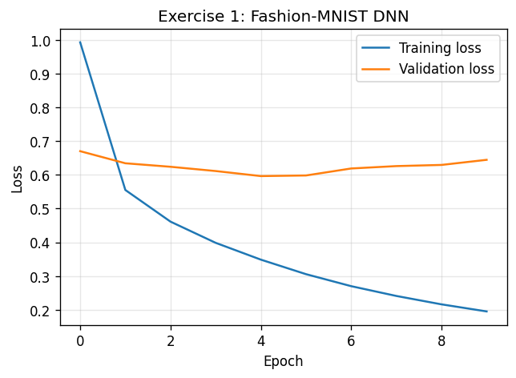
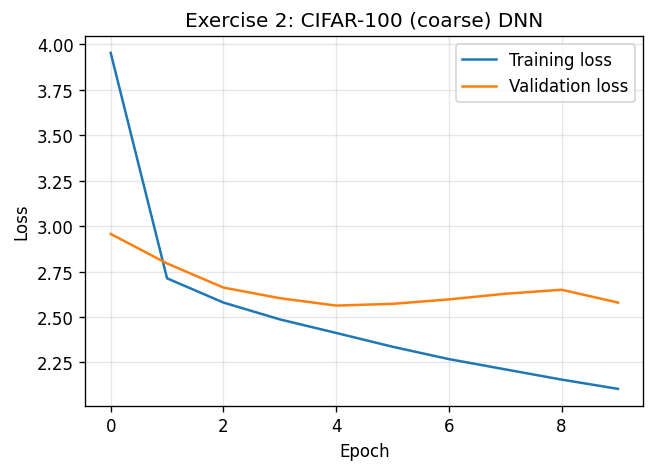
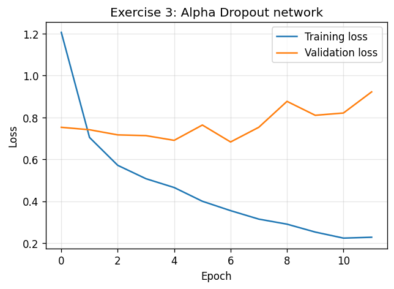
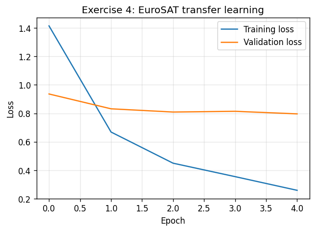
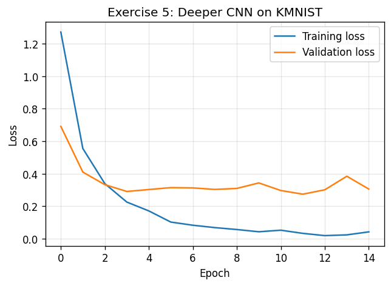
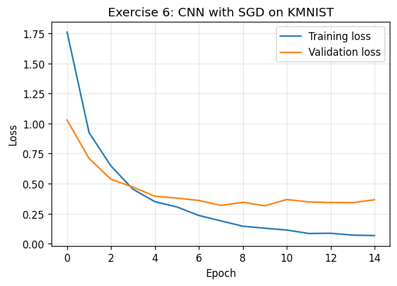

# IDATG2208 – Mandatory Assignment 3: Report

All code is in [`assignment3.py`](assignment3.py) and runs with `python3 assignment3.py`.
I used Python 3.9.6, TensorFlow 2.20.0 and tensorflow-datasets 4.9.3 on CPU, with seed 42 everywhere.
The raw output is in `run_log.txt`, the numbers are in `results.json` and the plots are in `plots/`.

## Results

| Question | What I trained | Test accuracy |
|---|---|---|
| Q1.1 | Fashion-MNIST DNN (ELU, He init, Nadam) | **82.00 %** |
| Q2.1 | CIFAR-100 (coarse) DNN | **19.40 %** |
| Q3.1 | Alpha Dropout network (SELU) | **82.25 %** |
| Q3.2 | Alpha Dropout + MC Dropout (20 passes) | **82.25 %** |
| Q4.1 | EuroSAT with frozen MobileNetV2 | **76.20 %** |
| Q5.1 | Deeper CNN on KMNIST (Adam) | **85.00 %** |
| Q6.1 | CNN with SGD, plain | **81.60 %** |
| Q6.2 | CNN with SGD + MC Dropout (20 passes) | **80.80 %** |
| Q6.3 | Average epistemic uncertainty (predictive variance) | **0.006** |

## Training and validation loss

### Exercise 1: Fashion-MNIST DNN
Early stopping ended training after 10 epochs. The best validation loss was at epoch 5.

### Exercise 2: CIFAR-100 (coarse) DNN
Training also stopped after 10 epochs, with the best validation loss at epoch 5.

### Exercise 3: Alpha Dropout network
Training stopped after 12 epochs. The best validation loss was at epoch 7.

### Exercise 4: EuroSAT transfer learning
This ran for the fixed 5 epochs.

### Exercise 5: Deeper CNN on KMNIST
This ran for the fixed 15 epochs. The best validation loss was at epoch 12.

### Exercise 6: CNN with SGD on KMNIST
This ran for the fixed 15 epochs. The best validation loss was at epoch 10.

## Problems I ran into

1. **EuroSAT download.** `tfds` downloads EuroSAT from `http://madm.dfki.de/files/sentinel/EuroSAT.zip`, and that server timed out for me. I added a check to the script. If the server can't be reached, `tfds` downloads the same RGB dataset from Zenodo (`EuroSAT_RGB.zip`). I didn't change the `tfds.load` call, the split strings or `shuffle_files=False`, so I get the same 2000/500 subsets. My final run used the Zenodo fallback.
2. **Q5.1 changed between runs.** My first run gave 83.40 % and the final run gave 85.00 %. I set seed 42, but TensorFlow on a multi-threaded CPU isn't fully deterministic. The other results were identical between the two runs. The numbers above are from the final run.

## Discussion

- **Ex. 1 and 2:** the training sets are small, so the validation loss reached its minimum at epoch 5 and then went up. This is overfitting. Early stopping restored the epoch-5 weights. 19.4 % on 20 classes is far above chance (5 %), but a plain MLP on raw CIFAR pixels with this little data is a weak model.
- **Ex. 3:** MC Dropout with 20 passes gave the same accuracy as the normal Alpha Dropout model (82.25 %), so it didn't help here. A rate of 0.1 doesn't change the predictions much between passes. The test set only has 400 samples, so one sample is worth 0.25 percentage points.
- **Ex. 4:** the frozen MobileNetV2 gave 76.2 % after only 5 epochs. The EuroSAT images are only 64×64, much smaller than what MobileNetV2 was trained on, and I only scaled to [0,1] as the assignment says. I expect fine-tuning some of the base layers would do better.
- **Ex. 5 and 6:** both CNNs overfit, with training accuracy at about 98–99 % while validation accuracy stayed around 91–93 %. The deeper CNN with Adam (85.0 %) did better than the smaller one with SGD (81.6 %).
- **Ex. 6:** MC Dropout gave a slightly lower accuracy than the plain model (80.8 % against 81.6 %). That is 4 out of 500 test samples, so I think it is just noise. The mean predictive variance is 0.006, which is low, so the model's predictions don't change much between dropout masks.
